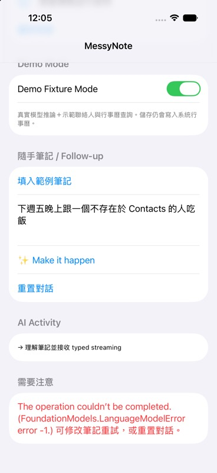
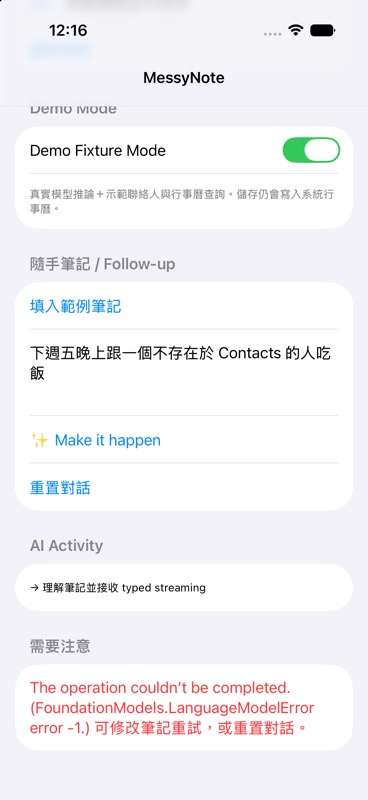

# MessyNote 驗證紀錄

初始日期：2026-10-21；最新驗證：2026-10-22。專案：`/Users/yitingsung/Developer/FMDemo`。初始階段建置log與xcresult位於 `/private/tmp/messynote-validation`；後續各輪路徑見對應章節，最新v12為 `/private/tmp/messynote-clock-grounding-v12-validation`。未commit、push或開PR；本紀錄不宣稱MERGE_READY。

## 命令與階段證據

共同參數：

```sh
PROJECT=/Users/yitingsung/Developer/FMDemo/MessyNote.xcodeproj
DERIVED=/private/tmp/messynote-validation/DerivedData
DEVICE=66FF8FF9-4132-4C55-92CC-1BCBA53F00A3
xcodegen generate --spec /Users/yitingsung/Developer/FMDemo/project.yml
xcodebuild -project "$PROJECT" -scheme MessyNote \
  -destination 'generic/platform=iOS Simulator' -derivedDataPath "$DERIVED" build
xcodebuild -project "$PROJECT" -scheme MessyNote \
  -destination "platform=iOS Simulator,id=$DEVICE" -derivedDataPath "$DERIVED" \
  -parallel-testing-enabled NO test
```

Release建置在build命令另加`-configuration Release`。Phase1–3與8使用build；Phase2、4、5、7使用test，test動作也包含app/test-target build。

| 階段 | 完成內容 | 證據log | 結果 |
|---|---|---|---|
| 1 | 真實Framework import／availability／session | phase1-build.log | exit0 BUILD SUCCEEDED |
| 2 red | 日期stub：tomorrow、nextWednesday預期失敗 | phase2-red.log | exit65；2項預期失敗 |
| 2 green | Guided Swift type、deterministic dates、最小respond | phase2-green.log | exit0；3 tests通過 |
| 3 | 真實partial streaming、取消、follow-up | phase3-build.log | exit0 BUILD SUCCEEDED |
| 4 red | 空檔與contact cardinality stub | phase4-red.log | exit65；新3測試6個預期assert失敗 |
| 4 green | 唯讀services、真實tools、ledger | phase4-green.log | exit0；6 tests通過 |
| 5 red | save boundary stub | phase5-red.log | exit65；2個預期assert失敗 |
| 5 green | 可編輯UI、review、唯一save邊界 | phase5-green.log | exit0；8 tests通過 |
| 6 | Debug-only fixtures、Release排除 | phase6-debug.log／phase6-release.log | 兩者exit0 BUILD SUCCEEDED |
| 7 | 日期邊界、取消、stale工具、permission、儲存競態 | phase7-tests.log | exit0；23 tests / 5 suites通過 |
| 8 | UI易讀性、error、鍵盤、文件 | phase8-build.log | exit0 BUILD SUCCEEDED |
| Follow-up red | 全覆寫會遺失姓名／重算相對日期 | followup-red.log | exit65；5 tests中9個預期issues |
| Follow-up green | typed revision合併、明確清除、保留有效草稿與舊patch取消 | followup-green.log | exit0；14 tests / 2 suites通過 |
| 未完成草稿 red | 缺時間後補時間錯走revision | missing-time-red.log | exit65；10 tests中1個預期失敗 |
| 歷史follow-up slice | 當時只讓已驗證草稿revision；已被pending baseline修正取代 | followup-final-green.log | exit0；15 tests / 2 suites通過 |
| 工具控制修正 | fresh single-tool DynamicProfile、required→disallowed | tool-control-build.log | exit0 BUILD SUCCEEDED |

Simulator首次啟動與test runner曾耗時約100–120秒；等待不是測試失敗。Xcode輸出`IDESchemeActionSDKRecord invalidDigitCount(94232)`，但test runner最終完成，以上成功依據是正式TEST SUCCEEDED與test結果。先前一次自動核准工具逾時，按工具允許重試一次後成功，沒有被當作程式錯誤。

## 自動驗證覆蓋

- 固定2026-10-21 Asia/Taipei：明天16:00、30分鐘結束16:30、提前120分鐘提醒；下週三15:00與60分鐘。
- 週日起算、同星期仍指下一週、跨年、無效年月日／時分、DST不存在時間、缺時刻、無效duration/reminder。
- 半開區間、不衝突、重疊與巢狀busy intervals、12小時有界空檔；15:00–16:00加16:00–16:30得到16:30。
- 聯絡人0／1／多候選；輸入姓名不匹配拒絕查詢；候選過期結果不能覆蓋新狀態。
- generate未觸發save；review本身未觸發save；最後confirm只save一次；重複點擊與權限等待中失效的review不能save。
- 舊generation的partial/result/error無法覆蓋新generation；取消重置session。
- denied工具不清掉草稿，Calendar保持unknown；手動編輯清除舊證據與聯絡人選擇；接受slot使舊calendar證據失效。
- fixtures僅有唯讀protocol，測試未對系統Contacts／Calendar寫入。

profile的實際模型tool call數與退出行為需要真模型integration trace；沒有以檢查本身條件式的鏡像單元測試冒充驗證。

## 後續回歸的red/green

| 修正 | Red實際觀察 | Green正式結果 |
|---|---|---|
| Pending日期baseline | pending-baseline-red.log：11 tests中的2個預期issues（revision flag、Friday）；測試已完成，xcodebuild收尾卡住後中止exit143 | pending-baseline-green.log：18 tests / 2 suites、TEST SUCCEEDED、exit0 |
| 手動補時間退路 | manual-time-red.log：14 tests中的3個預期issues（空實作不建立task／不報invalid day）；測試已完成，收尾卡住後中止exit143 | manual-time-green.log：14 tests / 1 suite、TEST SUCCEEDED、exit0 |

本段為10/21的41項來源基線；當時的43項source由scout核對全部OK（相較基線2新增、6修改，沒有無關來源變更）；最新[manifest](docs/final-source-sha256.txt)另納入正式UITest與shared schemes，數量及核對見最末節。

## 2026-10-21基線建置／測試（歷史）

**歷史階段IMPLEMENTATION_COMPLETE**：當時完整測試`final-manual-tests.log`／`final-manual-tests.xcresult`為 **36 tests / 6 suites，TEST SUCCEEDED，exit0**；最終iOS device Release為 **BUILD SUCCEEDED，exit0**。不宣稱MERGE_READY或完整實機驗收。唯一非失敗metadata訊息為無AppIntents依賴而略過提取，沒有compiler error。

先前source的`final-prompt-tests.log`為31 tests / 6 suites通過；此為歷史結果，已由上述36項最終完整測試取代。Pending baseline slice為18 tests / 2 suites通過（pending-baseline-green.log）；manual fallback slice為14 tests / 1 suite通過（manual-time-green.log），兩者均TEST SUCCEEDED、exit0。

最終完整測試的實際命令：

```sh
xcodebuild -project /Users/yitingsung/Developer/FMDemo/MessyNote.xcodeproj \
  -scheme MessyNote \
  -destination 'platform=iOS Simulator,id=66FF8FF9-4132-4C55-92CC-1BCBA53F00A3' \
  -derivedDataPath /private/tmp/messynote-validation/DerivedData \
  -resultBundlePath /private/tmp/messynote-validation/final-manual-tests.xcresult \
  -parallel-testing-enabled NO test
```

最終產品source的iOS device Release編譯已BUILD SUCCEEDED、exit0，log為final-manual-device-release.log。實際命令如下；驗證時關閉簽署不等於已安裝實機，專案本身仍是Automatic Signing。

```sh
xcodebuild -project /Users/yitingsung/Developer/FMDemo/MessyNote.xcodeproj \
  -scheme MessyNote -configuration Release -destination 'generic/platform=iOS' \
  -derivedDataPath /private/tmp/messynote-validation/DeviceDerivedData \
  CODE_SIGNING_ALLOWED=NO build
```

## Scenario證據層級（先前基線；最新見末節）

| 情境 | 已有證據 | 限制／尚未驗證 |
|---|---|---|
| A：Amy明天16:00、30分鐘、120提醒 | macOS真模型36 snapshots；2026-10-22 16:00、30分鐘、reminder120；真FindContact→Amy Chen、真CheckCalendar→0衝突 | iPhone真模型與真Contacts |
| B：小明下週三15:00、衝突與16:30 | macOS真模型45 snapshots；2026-10-28 15:00、60分鐘、reminder1440；真工具→王小明、Team Meeting；Swift空檔16:30 | iPhone完整流程、真Calendar與save |
| B follow-up：改16:30 | 48 snapshots；changes=[time]；10/28 16:30；姓名、地點、筆記、提醒保留；兩工具再次被呼叫且0衝突 | 模型mask仍可能語意錯誤，單次成功非保證 |
| C：晚上、找不到人 | 10/22修正後macOS真模型重現漏time-mask；35 initial／45 revision／7 clock snapshots；Friday10/30 19:00、60分鐘、阿不存在；真FindContact 0人、真CheckCalendar 0衝突 | macOS歷史回歸與正式Simulator UI端到端已通過（真模型＋唯讀fixtures）；沒有測系統權限、寫入或iPhone實機 |
| D：Calendar denied | 注入denied service驗證draft保留、unknown不宣稱無衝突 | 真實iOS權限拒絕對話 |
| E：模型不可用 | LifecycleTests驗證不啟動generator、無task/partial/event且原原因保留；availability與locale分支編譯 | 各種實機不可用原因逐一觸發 |
| F：飛航模式 | SystemLanguageModel.default與App無第三方模型／網路服務的架構證據 | 實機飛航模式完整推論 |

最終`simctl install`／`simctl launch`成功（com.demo.MessyNote，PID 9891）。主對話以`view_image`檢視冷啟動完成後的[首頁截圖](docs/simulator-home.png)，確認首頁完整顯示模型可使用、Fixture Mode關閉、筆記輸入與Make it happen按鈕。這只證明首頁安裝與啟動成功，不是互動端到端驗收；未操作真實權限或save。沒有iPhone實機、真權限、真實寫入或飛航模式驗證。

## 可攜真模型原始證據

這些是macOS host的SystemLanguageModel.default、availability=available且supportsLocale(zh_TW)=true，以memory fixtures執行最新AI/merge source。沒有建立writer，沒有接觸個人Contacts或Calendar，也不是iPhone實機。只保留兩份最終小型fixture log：

- [A/C最終原始log](docs/host-pending-final-ac.log)：A正確；C初次hour=nil，補充「晚上七點，吃飯一小時，同行者叫阿不存在」的values.hour=19但changes=[title,attendee]，未列time。共用merge保留nil，harness的未捕捉錯誤導致fatal missingTime；App有catch並保留pending草稿，不是App crash。
- [B/follow-up最終原始log](docs/host-pending-final-b.log)：45/48 snapshots、日期時刻與保留欄位，以及每輪實際FindContactTool／CheckCalendarTool activity。

B harness的小明fixture只有王小明一名，用於驗證工具通路；App Debug fixture含王小明／林小明，0／1／多候選另有deterministic測試。不可把host候選基數當作App fixture畫面證據。

## 診斷與修正邊界

真模型早期曾漏hour、把下週三抓成週一；同session工具review甚至只自由文字宣稱檢查完成而未call。UI從未採信該文字。現在parse session不注入tools，每個唯讀能力以fresh DynamicProfile session首次required、第一次onToolCall後disallowed；資料仍須通過draftID/query/generation驗證。

初次抽取改以英文控制、REFERENCE_CONTEXT／USER_NOTE分離，Guide明確相對日期、半小時30分鐘、optional真null與整點minute0；EventDraft使用representNilExplicitlyInGeneratedContent。型別只保證結構，不能保證星期、時刻或changes語意正確。

Follow-up使用typed EventRevision及共用GenerationResult merge，只修改changes允許的欄位，nil可明確清除。已驗證事件與pending草稿的合法日期都先由DateResolver.resolveDay固定explicit，單改時間、跨日補充不重新算相對日期。無效日不得被固定為合法日期。Red回歸已實際觀察舊分支flags錯誤與週五遺失；red測試完成後xcodebuild收尾卡住，程序被中止，不能將其exit143誤列為正常測試退出。Green為正式exit0。

## 歷史C手動時間退路（修正後仍保留為備用）

不再對同一失敗反覆調prompt，也不放寬changes讓錯誤values覆蓋原草稿。合法日期但hour=nil時，UI顯示固定草稿日期、時間DatePicker與「使用此時間並查詢」。文字明示選擇器不是模型抽取結果，必須由使用者按鈕確認。初次缺時間後即可直接使用此路徑；未提供姓名時可在完成後的有效event editor補姓名，編輯後需重新取得工具證據。

PlannerViewModel.completePendingTime只採用使用者時分，透過同一GenerationResult合併並驗證，接共用service.review；仍由模型發起真正唯讀tools，App沒有直接read捷徑。沒有自動儲存，原本人工save review邊界保持。Lifecycle tests驗證固定日期與19:00、review被呼叫、writer=0、invalid day拒絕、取消/reset後舊review不得復原草稿。測試中的generator是測試替身，不宣稱這段手動UI已在iPhone操作過。


## 2026-10-22：C窄型補時刻修正與最終驗證

開工前41項source SHA256全部符合既有manifest，沒有未知修改。新增ClockCompletion的單次補時刻路徑，不修改原revision prompt、不放寬allowlist。先保存一般revision的非時間修改；只有原pending與合併後都缺時間、且沒有明確time patch時，fresh session只從最新一句抽clock，再經原time merge保存日期。明確time=nil不補回。nil／非法clock保持pending且沒有review/save；取消、reset、mode switch拒絕舊clock與partial。

- 首輪deterministic red：c-clock-red.log，5 tests / 1 suite、8預期issues。測試已結束但診斷收尾卡住，終止exit143。
- 清除time保護red：c-clock-clear-red.log，6 tests / 1 suite、4預期issues；TEST FAILED、正式exit65。
- Green：c-clock-green.log，27 tests / 3 suites（PendingClock、Lifecycle、FollowUp），TEST SUCCEEDED、exit0。涵蓋Friday、姓名／時長／日期／clear、nil／非法clock、取消／重置／模式切換、已有time不額外抽取與原手動退路。
- 本機xcodebuild -help證明支援`-collect-test-diagnostics never`；使用後red正常退出，不再讓診斷收尾延遲混淆測試結果。

新component attempt1真模型證據：reference2026-10-22的C完整流程得到Friday10/30 19:00、阿不存在與真tools，但該輪一般revision正確包含time，額外clock次數為0，不能據此證明漏mask分支。Clock-only「晚上七點半」「19:45」及模糊「晚上再說，時間還沒決定」通過；「一小時，提前兩小時提醒」卻抽成hour1，判定FAIL。原始log位於`/private/tmp/messynote-c-validation/host-c.log`，此歷史失敗不以後續結果覆寫。

Attempt2只修改ClockCompletion.hour Guide及clock-only instructions，加入每日鐘點與時長／提醒offset對照，要求先辨識鐘點再填數值；只有duration/reminder必須null，混合句只取clock。沒有新增regex或關鍵字Swift解析、沒有新增模型欄位或修改合併。Attempt2真模型結果：**PASS、exit0**，可攜原始證據為[host-c-attempt2.log](docs/host-c-attempt2.log)。固定reference為2026-10-21 Asia/Taipei，重現一般revision changes=[title,attendee]確實漏time；初次35 snapshots、revision45 snapshots，shared helper再產生7個真實clock snapshots。最終日期保留Friday2026-10-30，時間19:00、時長60分鐘、姓名阿不存在；真正FindContactTool返回0人、CheckCalendarTool返回0衝突，沒有writer。這次不是靠正常time mask碰巧通過。

六種窄型clock真模型變體全部通過：晚上七點半→19:30；19:45→19:45；模糊晚上→nil；純時長與提前提醒→nil；鐘點＋時長＋提醒→19:00；只改日期＋時長→nil。Attempt1曾把duration當clock的FAIL保留為歷史證據，不能被新結果抹除。所有結果仍是macOS host實際模型加memory fixtures，不是iPhone實機保證。

此段為ClockCompletion完成時的歷史結果；當時Simulator自動化尚未證實中文binding輸入，舊runtime亦有模型資產錯誤。後續正式XCUITest結果見最末節。當時歷史階段狀態為 **IMPLEMENTATION_COMPLETE**：XcodeBuildMCP `test_sim`正式SUCCEEDED，**42 passed／0 failed／0 skipped，25.8秒**；generic iOS **Release BUILD SUCCEEDED、exit0**。測試摘要另保存為[c-tests-summary.txt](docs/c-tests-summary.txt)，結果bundle為`/private/tmp/messynote-c-validation/full-tests.xcresult`。Release log為`/private/tmp/messynote-c-validation/device-release-final.log`。最新43項source manifest核對全部OK。

本輪完整測試透過XcodeBuildMCP指定MessyNote scheme、iPhone 18 Pro simulator及extra args `-parallel-testing-enabled NO -collect-test-diagnostics never`執行；以下是可重跑的CLI入口：

```sh
xcodebuild -project /Users/yitingsung/Developer/FMDemo/MessyNote.xcodeproj \
  -scheme MessyNote -configuration Debug \
  -destination 'platform=iOS Simulator,id=66FF8FF9-4132-4C55-92CC-1BCBA53F00A3' \
  -derivedDataPath /private/tmp/messynote-validation/DerivedData \
  -parallel-testing-enabled NO -collect-test-diagnostics never test
xcodebuild -project /Users/yitingsung/Developer/FMDemo/MessyNote.xcodeproj \
  -scheme MessyNote -configuration Release -destination 'generic/platform=iOS' \
  -derivedDataPath /private/tmp/messynote-validation/DeviceDerivedData \
  CODE_SIGNING_ALLOWED=NO build
```

上述macOS模型＋fixture結果及unit tests各自獨立，不代替UI驗證。後續正式Simulator案例C已通過；iPhone實機、實際權限／save、飛航模式仍未測。模型語意仍可能錯誤，手動時間確認保留為備用。不宣稱MERGE_READY。


## 歷史Simulator案例C調查：舊runtime阻塞與輸入假陽性

**歷史結果，已被最末節的正式XCUITest PASS取代。** 當時CUA操作Device Hub（`com.apple.dt.Devices`），AX `setValue`讓畫面顯示中文、Fixture ON，按下Make it happen後出現模型錯誤。後續查證AX值未同步SwiftUI binding，因此先前「中文輸入已解決」的判斷撤回：這些截圖證明顯示與runtime錯誤，不能證明模型收到案例C原文。

首次UI顯示`FoundationModels.LanguageModelError error -1`；沒有產生draft，未進入follow-up、ClockCompletion或Contacts／Calendar tools。重啟指定iPhone 18 Pro／iOS 27.0 Simulator（`66FF8FF9-4132-4C55-92CC-1BCBA53F00A3`）再執行，UI顯示相同錯誤。兩次都沒有手動選時間、沒有儲存Calendar；最後畫面保留初始中文與錯誤、Fixture Mode ON，Capture Keyboard已確認還原OFF。

| 證據層級 | 本次結果 |
|---|---|
| Swift測試／編譯 | 既有42 passed、0 failed、0 skipped與Release BUILD SUCCEEDED維持；本輪沒有改source/tests，因此沒有重跑build/test |
| macOS真模型＋memory fixtures | 歷史C漏time-mask回歸與六個clock變體PASS；不是Simulator或iPhone結果 |
| 當時Simulator實際UI | 畫面顯示中文但binding輸入未證實；初次generation遭runtime資產錯誤阻塞，未到draft／follow-up／tools；不是C端到端通過證據 |
| iPhone實機 | 尚未驗證 |

確定的系統證據：首次12:04:31及重啟後12:15:35的HostInferenceProvider均記錄`Failed to look up runner asset object`，asset bundle為`com.apple.fm.language.instruct_3b.fm_api_generic`；隨後Model Catalog回報沒有underlying assets、`UnifiedAssetFramework Code=5000`，App接收ExecuteRequest錯誤。公開UI的error -1無法由現有資料精確映射成FoundationModels公開enum case。availability顯示可用與實際runner載入失敗可以同時存在；不能把availability當成成功推論證據。

本機查到Xcode 27.1、iOS 27.0 runtime、macOS 27.0.1。Apple Developer Forums的staff回覆支持版本對齊作為排查方向，但不是這組版本的根因證明或修復保證；不能把版本不齊直接宣稱為唯一根因。Info.plist的`DTXcodeBuild=27A9274`與先前SDK/build記錄的`27A9275`來自不同來源，診斷保留此差異而不據此推論根因。現有安裝沒有第二套可切換的完整Xcode；本次沒有下載、升級或切換工具鏈。

可攜診斷文件：

- [首次runtime時序與App邊界](docs/c-ui-runtime-diagnosis.md)
- [重啟後相同runner asset／Code 5000證據](docs/c-ui-restart-runtime-diagnosis.md)
- [官方資料與修復方向的限定](docs/c-ui-remediation-research.md)
- [既有工具鏈與更新目錄查證](docs/c-ui-existing-toolchain-research.md)

歷史首次推論錯誤（畫面顯示中文、Fixture ON，binding未證實，未產生草稿）：



重啟後相同UI錯誤（不是空白啟動畫面）：



當時該輪只更新驗證文件及複製證據，沒有修改App source或tests。主對話執行`shasum -a 256 -c docs/final-source-sha256.txt`，43項全部OK、exit0；來源未變，無需重跑既有測試或編譯。不把runtime基礎設施阻塞當成程式測試失敗，也不把host模型成功當成UI端到端成功。


## 正式Simulator案例C UI端到端驗證通過

2026-10-22：**PASS，1 passed／0 failed／0 skipped，約99秒**。可攜[測試摘要](docs/c-ui-pass/tests-summary.json)及[正式test log](docs/c-ui-pass/test_sim_second.log)來自`c-ui-second.xcresult`。獨立Simulator為MessyNote Case C QA（iPhone 18 Pro，iOS27.0正式版24A434，UDID `280085F1-11D0-4221-B90F-59FD4226E464`）。

環境修復：移除先前iOS27.0 beta2 image（24A5370g），安裝Apple官方iOS27.0（24A434），建立獨立Simulator後，實際模型推論恢復。沒有刪除或抹除既有Simulator device。[環境與輸入調查](docs/c-ui-pass/official-runtime-progress.md)保留完整順序。這是實測恢復，不把版本不齊宣稱為已證實唯一根因。舊AX setValue只改畫面值、未更新binding；正式解法是XCTest Unicode typeText。Clipboard roundtrip及工具回報成功都不單獨作為輸入成功證據。

首輪XCUITest在Fixture開關失敗，未進中文輸入：外層Switch frame為{16,439.7,370,52}，實際內層Switch為{309,451.7,63,28}，原tap命中外層列中央(201,465.67)。[首輪階層](docs/c-ui-pass/first-fixture-hierarchy.txt)支持此定位。僅將fixture點擊改為normalized(0.9,0.5)，並predicate等待value==1最多5秒；未改產品邏輯或其他selector，第二輪正式通過。

測試使用真實`XCUIApplication`、`typeText`與button tap。初次輸入「下週五晚上跟一個不存在於 Contacts 的人吃飯」，取得缺時間草稿；記錄當次計算的下一週五Friday2026-10-30。接著清除輸入並輸入「晚上七點，吃飯一小時，同行者叫阿不存在」，再次生成後核對同一日期、19:00、60分鐘及阿不存在，pending消失。最後畫面及activity確認FindContactTool(阿不存在)與CheckCalendarTool(7:00 PM)，兩個查詢各自空結果。

| 可攜證據 | 驗證內容 |
|---|---|
| [04 pending截圖](docs/c-ui-pass/04-fixed-Friday.png)／[階層](docs/c-ui-pass/04-fixed-Friday-hierarchy.txt) | 缺時間草稿固定Friday October30,2026 |
| [05 follow-up截圖](docs/c-ui-pass/05-follow-up.png)／[階層](docs/c-ui-pass/05-follow-up-hierarchy.txt) | 真實Unicode typeText補充完整中文 |
| [07 event截圖](docs/c-ui-pass/07-event.png)／[階層](docs/c-ui-pass/07-event-hierarchy.txt) | 同日期7:00PM、60分鐘、阿不存在 |
| [08–09空結果截圖](docs/c-ui-pass/08-09-empty-results.png)／[Contacts階層](docs/c-ui-pass/08-empty-contacts-hierarchy.txt)／[Calendar階層](docs/c-ui-pass/09-empty-calendar-hierarchy.txt) | 聯絡人0人、Calendar0衝突 |
| [10 tools截圖](docs/c-ui-pass/10-tools.png)／[階層](docs/c-ui-pass/10-tools-hierarchy.txt) | 兩個真正模型tool calls可見 |

主對話已透過view_image視覺核對04、07、10截圖。這是**真實FoundationModels＋唯讀fixture providers的Simulator UI E2E**，沒有VM注入、預填答案或假模型；沒有使用手動時間picker、沒有按加入行事曆、沒有寫Calendar。它不涵蓋系統Contacts／Calendar授權及真實資料整合，也不證明這輪必定走額外clock分支（該分支另有host歷史漏mask回歸）。iPhone實機、權限對話、實際save、飛航模式仍未驗證。

獨立opt-in scheme `MessyNoteCaseCUI`只包含`MessyNoteUITests`；原`MessyNote` scheme維持42項unit tests。模型不可用、runtime錯誤或180秒內未完成均失敗，沒有skip。可重跑入口（請改成當前可用Simulator UDID）：

```sh
xcodebuild -project /Users/yitingsung/Developer/FMDemo/MessyNote.xcodeproj \
  -scheme MessyNoteCaseCUI -configuration Debug \
  -destination 'platform=iOS Simulator,id=280085F1-11D0-4221-B90F-59FD4226E464' \
  -parallel-testing-enabled NO -collect-test-diagnostics never \
  -only-testing:MessyNoteUITests/CaseCUITests/testCaseCNaturalLanguageCompletion test
```

本次最終unit tests另行執行：**42 passed／0 failed／0 skipped，17.8秒**，結果為`/private/tmp/messynote-c-ui-validation/final-unit-tests.xcresult`。產品與test來源在文件收尾期間未改；manifest涵蓋Swift產品、unit/UI tests、project.yml、project.pbxproj及shared schemes，不含docs或自身。

最終iOS device Release：**BUILD SUCCEEDED、exit0**，原始log：`/private/tmp/messynote-c-ui-validation/final-release-build.log`；[可攜最終命令與結果摘要](docs/c-ui-pass/final-validation-summary.txt)記錄本次UI、unit與Release結果。命令為：

```sh
xcodebuild -project /Users/yitingsung/Developer/FMDemo/MessyNote.xcodeproj \
  -scheme MessyNote -configuration Release -destination 'generic/platform=iOS' \
  -derivedDataPath /private/tmp/messynote-validation/DerivedData CODE_SIGNING_ALLOWED=NO build
```

此歷史階段的來源SHA256清單當時共46項，納入UI test與兩個shared schemes；當時核對46項全部OK、exit0，主對話亦獨立核對。當時狀態為**IMPLEMENTATION_COMPLETE**，不是目前整體驗收結論；現行manifest已於最末節更新，不以歷史清單代表目前來源。


## 歷史產品候選與分次UI驗收

此節保留當時54項unit與B未完成驗收的歷史；後續使用者明確授權超過原上限繼續修復，最新結果見最末v7節。

**Unit：54 passed／0 failed／0 skipped**，見[原始摘要](docs/final-acceptance/unit-summary.json)。xcresult top-level統計為54項；device configuration為69 passed，statistics為8個動態參數測試／23個參數執行。因此也可描述參數展開69次，但主要統計仍用54。**Release：exit0、BUILD SUCCEEDED**；[命令與結果摘要](docs/final-acceptance/build-results.txt)記錄generic iOS／CODE_SIGNING_ALLOWED=NO，不是實機部署。

最新A–D原suite維持**3 passed／1 failed／0 skipped（Failed）**，見[未改寫verdict的摘要](docs/final-acceptance/a-d-summary.json)。A、C、D通過；B當時在Select All階段失敗，未發follow-up。最後B獨立結果為**0 passed／1 failed／0 skipped**：Fixture已1，但第149行清空輸入斷言失敗，尚未生成。[最後AX](docs/final-acceptance/b-final-input-failure.txt)只顯示placeholder且無value，不能推測XCTest value實際為nil或非空，也不能認定有殘留內容。

前次B獨立測試已核對16:30、原日期與欄位、真工具及王小明選擇，review也顯示正確`1,440 分鐘前提醒`；當次因測試期待未分組字串而失敗，未執行取消。這些是局部成功證據，不能合併成整項PASS。後續tool等待逾時沒有可判斷時刻的DatePicker AX，不能記為模型誤抽或仍15:00；再後續的fixture/setup及輸入失敗均尚未觸發模型。新tool定位helper尚未實際驗證。

[B逐次結果、摘要與原始路徑](docs/final-acceptance/b-run-comparison.md)保留上述界限。達到同一輸入元件首次加兩次修正上限，停止產品／測試修正與重跑。**整體驗收未完成，不標示IMPLEMENTATION_COMPLETE或MERGE_READY**。JSON僅遮蔽deviceId，未更改verdict、統計或failure內容。

| 情境 | 最新已核對結果 | 可攜證據 |
|---|---|---|
| A | 真模型＋fixtures：明天16:00、30分鐘、120提醒、Amy Chen、Calendar無衝突；開啟review再取消 | [草稿](docs/final-acceptance/a-event.png)／[AX](docs/final-acceptance/a-event.txt)、[工具](docs/final-acceptance/a-tools.png)、[review](docs/final-acceptance/a-review.png)、[取消後](docs/final-acceptance/a-canceled.png) |
| B | 整項未完成驗收；前次核心流程與review值正確，未完成取消；最後停在輸入斷言、尚未生成 | [16:30欄位](docs/final-acceptance/b-preserved-fields.png)／[AX](docs/final-acceptance/b-preserved-fields.txt)、[工具](docs/final-acceptance/b-followup-tools.png)、[review](docs/final-acceptance/b-review.png)、[最後失敗](docs/final-acceptance/b-final-input-failure.png)、[逐次結果](docs/final-acceptance/b-run-comparison.md) |
| C | 最新產品版本PASS（76.317秒）；10/30 19:00、60分鐘、阿不存在，真工具0結果 | [固定日期](docs/final-acceptance/c-pending.png)、[完成草稿](docs/final-acceptance/c-event.png)／[AX](docs/final-acceptance/c-event.txt)、[工具](docs/final-acceptance/c-tools.png) |
| D | Real Mode真Calendar prompt拒絕；完整draft保留、衝突unknown，不顯示無衝突 | [系統prompt](docs/final-acceptance/d-system-prompt.png)／[AX](docs/final-acceptance/d-system-prompt.txt)、[拒絕說明](docs/final-acceptance/d-denied.png)、[草稿](docs/final-acceptance/d-draft.png)、[工具拒絕](docs/final-acceptance/d-tools.png)／[AX](docs/final-acceptance/d-tools.txt) |

A/C使用真正FoundationModels及只替代讀取資料的fixture providers；D使用真正Simulator系統授權路徑。這些都不是iPhone實機結果。沒有手動選時間、沒有建立系統Contacts、沒有按最終Calendar寫入確認。A的review可開可取消，不能當save成功；D拒絕也不等於允許權限後的真Calendar資料讀取整合。

### 本輪三類產品修復與回歸

- B follow-up曾真正SIGTRAP：SwiftUI `BindingOperations.ForceUnwrapping.get`與generate同步event=nil相符。現在`editorBinding(for:)`可供離場editor安全讀snapshot，setter須同generation且非loading/saving/saved；舊binding不能復活或覆寫event。generate仍清空event，原save gate保留。新增3項回歸已包含於54項正式unit。
- 初次明確時刻漏hour：原helper只服務previousPending，新initial缺hour也可從同一句note做一次fresh ClockCompletion。nil仍pending、非法拒絕；日期及其他欄位保持。Revision/time清除規則未放寬。
- 初次半小時錯成60：新增DurationCompletion與fresh duration-only抽取，明確區分活動持續時間、鐘點、提醒offset。initial才抽，nil沿用既有duration，非法拒絕，只改duration。Revision完全不追加duration call。保留初始EventDraft typed streaming；沒有regex或測試字串特判，沒有假模型或重試迴圈。

Clock與duration回歸涵蓋欄位保留、模糊／非法值、已有clock不追加、revision不call、取消／reset／mode與舊generation不覆蓋。窄型抽取仍是模型推論，不能保證每次理解正確，額外呼叫也增加延遲。

測試本身另修正了已證實的定位問題：無label筆記欄、keyboard附近Form捲動、review期間disabled的DatePicker不能以isHittable判為不存在。C曾有正確10/30 19:00/60草稿卻被舊helper捲離；修正只處理定位，不放寬真值斷言。B的Select All、清空placeholder、1440格式及虛擬化tool等待分別記錄為測試定位／斷言問題；最後輸入斷言仍失敗，不宣稱已修好。與已證實的產品問題分開。

### E官方診斷、locale與F界限

E用Xcode官方Run的`foundationModelsAvailabilityOverride`，確認[modelNotReady](docs/final-acceptance/e-model-not-ready.jpg)／[AX](docs/final-acceptance/e-model-not-ready.json)與[deviceNotEligible](docs/final-acceptance/e-device-not-eligible.jpg)／[AX](docs/final-acceptance/e-device-not-eligible.json)兩個UI分支。另保存[ineligible scheme](docs/final-acceptance/e-device-not-eligible.xcscheme)的官方設定；modelNotReady以當次Run截圖與AX為證據。這是診斷狀態模擬，不是實機模型下載或硬體限制實測。

一次隔離build-for-testing探測顯示LaunchAction override沒有傳到xctestrun，即使shouldUseLaunchSchemeArgsEnv=YES也沒有對應屬性、args或env；因此使用官方Xcode Run，沒有猜private環境變數或將無效E UI test加到產品專案。

[Polish scheme](docs/final-acceptance/e-polish-probe.xcscheme)設定language=pl且override關閉，但[AX](docs/final-acceptance/e-polish-probe.json)仍顯示modelNotReady；未取得supportsLocale=false／不支援目前語系畫面，故unsupported locale為INCONCLUSIVE／未驗證。Apple Intelligence disabled沒有對應實測，未修改主機AI設定。

F仍未驗證：必須在相容實機模型已就緒後真正開啟飛航模式並完成核心推論；Simulator外觀、fixtures、無第三方模型的架構證據都不能代替。Contacts／Calendar可能有系統或iCloud同步，不宣稱全部資料永不離開裝置。

### 最新實機preflight

[唯讀preflight](docs/final-acceptance/phone17-preflight.md)確認iPhone17Pro（iPhone18,1）、iOS27.0.1／24A446，connected、wired、paired、Developer Mode 1；xcodebuild showdestinations列為相同可選iOS目的地。這是當時已通過的前置確認，取代僅有iPhone15Plus的舊描述；15Plus當時unavailable。其後[2026-10-22 16:26:44 CST最後查核](docs/final-acceptance/final-device-connection.md)顯示17Pro也已unavailable，不能說目前仍connected。需重新連接後選Team並確認模型就緒；這不代表Team或硬體能力改變。

本專案DEVELOPMENT_TEAM仍空，Automatic Signing已設但未選Team；沒有App安裝或執行證據。主機升權查詢有7個有效signing identities，先前sandbox內0個不能當主機狀態。公開devicectl欄位未提供Apple Intelligence啟用／模型就緒／supportsLocale結果，因此這些仍未知。此輪只確認具備進一步實機測試的裝置前提，沒有讀取裝置內容或寫入資料。

### 重跑入口與證據保存

在專用測試Simulator先reset Calendar，再跑UI suite，否則已拒絕權限不會再出prompt；不要對使用中的個人測試資料環境任意重設。命令如下（以專用測試機UDID替代placeholder）：

```sh
xcrun simctl privacy <YOUR_SIMULATOR_UDID> reset calendar com.demo.MessyNote
xcodebuild -project MessyNote.xcodeproj -scheme MessyNoteAcceptanceUI \
  -destination 'platform=iOS Simulator,id=<YOUR_SIMULATOR_UDID>' \
  -parallel-testing-enabled NO -collect-test-diagnostics never test
xcodebuild -project MessyNote.xcodeproj -scheme MessyNote \
  -destination 'platform=iOS Simulator,id=<YOUR_SIMULATOR_UDID>' \
  -parallel-testing-enabled NO -collect-test-diagnostics never test
xcodebuild -project MessyNote.xcodeproj -scheme MessyNote -configuration Release \
  -destination 'generic/platform=iOS' CODE_SIGNING_ALLOWED=NO build
```

[附件來源對照](docs/final-acceptance/selected-attachments.json)保存測試stage與原始附件檔名；只選有用截圖／AX與摘要，不複製巨大xcresult或完整activities，也不保存完整device UDID／credentials。舊docs證據未覆蓋。最終來源清單見下方；保留B失敗，不等待或暗示後續一定通過。


### 最後來源凍結與文件驗證

現行[來源manifest](docs/final-source-sha256.txt)及[可攜副本](docs/final-acceptance/sources.sha256)涵蓋52個Swift app／unit／UI、project.yml、pbxproj及shared scheme檔案，路徑相對於專案根目錄；不包含文件、自身、build或userdata。[歷史46項清單](docs/final-acceptance/historical-case-c-source-sha256.txt)另存，僅作歷史證據，不能拿來檢查現行來源。

最後文件整理沒有修改任何Swift／project／scheme，也沒有再建置、啟動Simulator或執行測試。來源checksum與相對文件連結檢查結果另見[文件驗證摘要](docs/final-acceptance/document-validation.txt)。這些檢查只證明封存一致性，不把B未完成驗收改為PASS。


## 歷史v7驗收：B完整通過

使用者明確授權繼續修復並超過原輸入元件重試上限；因此前節停損與B未完成為歷史狀態。v7 **B完整UI單次Passed、264.086秒；unit56全通過；unsigned generic iOS Release exit0／BUILD SUCCEEDED**。[完整說明與精選附件](docs/final-acceptance/v7/verification.md)保留輸入raw、提交開始、16:30工具／欄位及review取消證據，不以拼接不同run取代整項測試。

該輪後續A/D通過，C先setup失敗、修正後出現18:00；當時initial猜時間假說後被診斷修正，C未通過。後續v8–v10見最末節。E僅官方兩診斷分支，locale未定、AI disabled未測；F仍待實機。17:31 CST裝置快照為15Plus有線connected、17Pro unavailable，未選Team、沒有部署、模型就緒未知。[裝置紀錄](docs/final-acceptance/v7/device-1731.md)。

目前兩份來源manifest已更新52項，先前manifest另存在[v7歷史副本](docs/final-acceptance/v7/historical-before-v7-sources.sha256)。文件收尾不改source或重新執行測試；最終連結與checksum檢查待本輪其餘結果封存。


## 歷史v10驗收：C通過，A失敗、B取消、D未跑

**58項unit全通過、Release exit0／BUILD SUCCEEDED、C完整UI PASS。** [v10詳細結果](docs/final-acceptance/v10/verification.md)保存固定日期、中文follow-up、19:00真工具，以及v7→v10逐版本修正／失敗。v7、v8的B曾完整通過；v8和v9的C仍失敗，均未改寫為PASS。v10後續A正式FAIL；B被取消而未完成，D未執行，不能替其製造verdict。[中斷證據](docs/final-acceptance/v10/abd-interrupted-evidence.md)另存。

當時v10 initial一律以fresh clock確認（v11已撤回此額外閘門）；hasExplicitStartTime分類先於hour/minute，false可阻擋猜測數值。分鐘未說則nil，只在明確hour下由Swift用0。v10只用繁中Guide／prompt校正只有時段與中文鐘點的區別；真C診斷顯示初次false、follow-up true19:00，原日期仍10/30。這是當次實測，不保證模型永遠穩定。

本輪只做文件整理，未改產品、測試或設定；等待A/B/D與最後連線刷新後才更新最終manifest及連結檢查。E仍部分驗證、F實機飛航未驗證；最近17:56查核17Pro unavailable，無Team或實機部署證據。


## 歷史v11：缺hour才補抽，C/A通過、B取消、D未跑

該版**58項unit通過、Release與UI建置exit0成功**。C（104.843秒）與A（207.542秒）真正PASS；B觀察到缺hour後fresh clock回false，主對話停止suite，exit75，B未取得完整verdict，D未執行。[v11驗證說明](docs/final-acceptance/v11/verification.md)保存TDD及範圍。

v8將C的18:00暫推為initial非nil hour繞過補抽，遂增加全initial重抽／清除；後來診斷顯示初稿nil、fresh clock才產18，並不支持當時假說。v10又將A正確16:00與B正確15:00清掉：A正式FAIL、B取消、D未跑。v11撤回額外閘門，只補draft.hour=nil，保留v9Bool／optional分鐘與v10繁中Guide，不放寬UI日期／時分／工具斷言。

v10 C的EE1C…附件名雖含completed，實際仍partial／loading，不能當final截圖。19:00以AX及診斷核對；93F3…工具截圖才是終態。[校正註記](docs/final-acceptance/v10/verification.md#v10圖證標註校正)保存來源。

當時文件收尾尚未更新最終manifest，仍等待同版sealed UI及最後裝置連線查核；現行清單與最新結果見下方v12節。E部分驗證與F未驗仍保留。


## 最終v12：同版A–D完整通過

**62項unit通過、0失敗／0略過；同一來源與建置的A–D共4項真UI驗收全通過；UI／unit建置與unsigned generic iOS Release均exit0。** BC與AD分兩次執行，各2 passed／0 failed／0 skipped，均TEST EXECUTE SUCCEEDED。[BC摘要](docs/final-acceptance/v12/bc-summary.json)、[AD摘要](docs/final-acceptance/v12/ad-summary.json)、[unit摘要](docs/final-acceptance/v12/unit-summary.json)、[完整精選證據](docs/final-acceptance/v12/verification.md)。A128.329秒、B245.649秒、C73.690秒、D69.276秒。

ClockCompletion新增clockPhrase；service以原文substring核對，保留explicit分類、optional分鐘及缺hour才補抽政策。欄位排列是設計意圖，不宣稱API保證推理順序。當次B初稿hour=nil，真正fresh clock為sourceAccepted=true／explicit=true／15:00，後續revision只改time成16:30；C初次false／nil保持待確認，補充後sourceAccepted=true／19:00、原10/30保持。[診斷摘要](docs/final-acceptance/v12/clock-diagnostics.txt)保存路徑，不記私人文字。原文包含片段不保證語意永遠正確，不把這次PASS當模型穩定性保證。

B完整涵蓋清空與中文輸入、兩候選／衝突、Swift16:30空檔、真follow-up日期欄位保留、兩工具重查、選王小明、review開啟與取消。C全程自然語言，沒有手動picker。A/B/C使用真FoundationModels及readonly fixtures；D是真Simulator Calendar權限prompt拒絕、草稿保留與未知狀態。沒有最終Calendar寫入，不宣稱系統資料成功讀寫整合或實機完成。

[23:37實機前置檢查](docs/final-acceptance/v12/phone17-preflight-redacted.md)確認17Pro connected（localNetwork／TCP）、Developer Mode enabled、Xcode eligible。這取代最近available/unavailable作當前描述，但歷史快照不覆寫。Team仍空；沒有簽署安裝、App執行或模型就緒證據。E僅官方modelNotReady/deviceNotEligible兩分支，locale未定、AI disabled未驗；F實機飛航仍待驗。因此不宣稱A–F全部完成或MERGE_READY。

本次文件收尾保持產品／測試／設定freeze。兩份52來源manifest重新產生，舊清單保留於[v12歷史副本](docs/final-acceptance/v12/historical-before-v12-sources.sha256)。[文件核對](docs/final-acceptance/v12/document-validation.txt)記錄來源checksum與本地連結結果；沒有commit、PR或部署。
