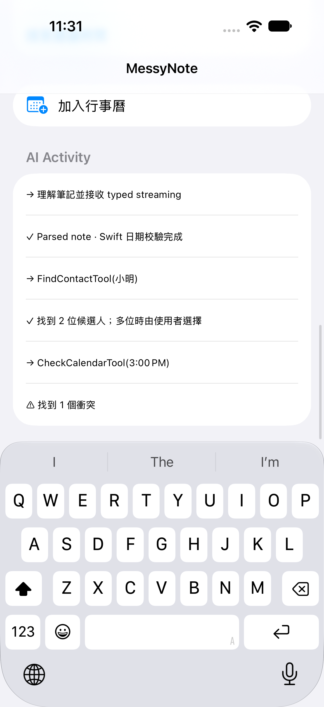
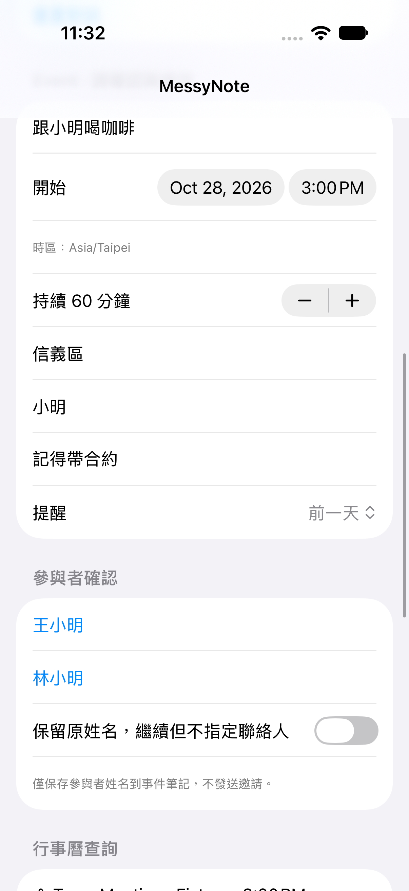
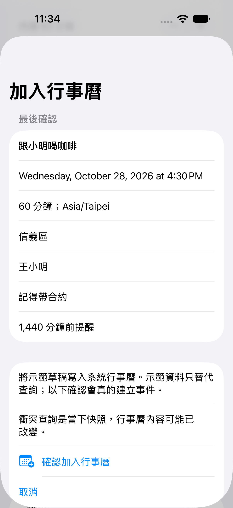
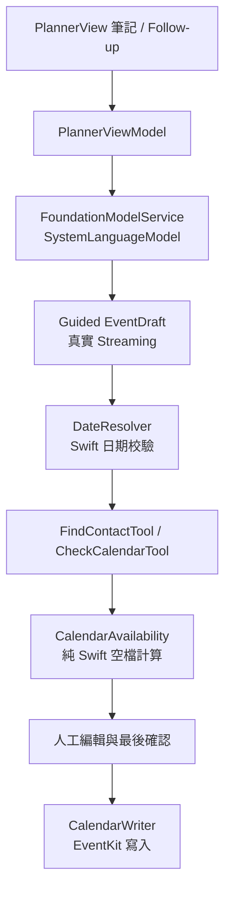

# MessyNote

**Turn messy thoughts into plans.**

隨手打一句「下週三下午三點跟小明在信義區喝咖啡一小時，記得帶合約，前一天提醒我」，MessyNote 會用 Apple 裝置端模型把它整理成行事曆事件：解析日期時間、查聯絡人、檢查行程衝突、建議空檔，最後由你確認才寫入行事曆。

這是一個 SwiftUI 技術展示專案，示範 iOS 27 [Foundation Models framework](https://developer.apple.com/documentation/foundationmodels) 的 Guided Generation、真實 streaming 與 Tool calling。全程在裝置上推論，不需要任何雲端 LLM 金鑰。

<p align="center">
  
  
  
</p>

## 功能

- **筆記轉事件**：輸入自然語言，模型直接產生 `@Generable` Swift 型別，不經過「JSON 字串 → JSONDecoder」。
- **真實 partial streaming**：欄位隨模型輸出的 snapshot 逐步出現，沒有假 timer。
- **模型發起的唯讀工具**：`FindContactTool` 查聯絡人、`CheckCalendarTool` 查行程衝突，空檔由純 Swift 計算。
- **對話式修改**：可以接著說「改成 16:30」或「晚上七點，吃飯一小時」，只會更新你要求修改的欄位。
- **人工確認**：多位同名聯絡人由你選擇，不讓模型替你挑人；寫入行事曆前一定會出現最後確認畫面。
- **誠實的不確定**：沒有權限或模型沒呼叫工具時顯示「未知」，不會宣稱沒有衝突。

## 需求

| 項目 | 版本 |
|---|---|
| Xcode | 27.1 以上 |
| iOS 部署版本 | 27.0 |
| Swift | 6（strict concurrency complete） |
| 執行真實模型 | 支援 Apple Intelligence、已開啟且模型下載完成的裝置（例如 iPhone 15 Pro 以後的相容機型） |

裝置與語言的支援範圍以 [Apple 官方說明](https://support.apple.com/en-us/121115) 為準，App 會在執行時檢查 `availability` 與 `supportsLocale`。

## 開始使用

```sh
git clone https://github.com/ting3242006/FoundationModelsDemo.git
cd FoundationModelsDemo
open MessyNote.xcodeproj
```

1. 選擇 `MessyNote` scheme。
2. 實機執行時，到 **Signing & Capabilities** 選擇自己的 Team。
3. Build & Run。

專案由 [XcodeGen](https://github.com/yonaskolb/XcodeGen) 的 `project.yml` 產生，只有要重建專案檔時才需要執行 `xcodegen generate`。

### Demo Fixture Mode

Debug build 可以切換成 Demo Fixture Mode，用固定的聯絡人與行事曆資料展示（例如「小明」會出現王小明、林小明兩位候選）。只有唯讀資料被替換，模型推論、streaming 和 tool calling 仍然是真的。Release build 不會包含這個模式。

## 架構



```
MessyNote/
├── AI/                 模型 session、工具、ToolLedger、錯誤分類
├── Models/             @Generable 語意型別、revision、已驗證事件
├── Services/           日期解析、空檔計算、Contacts／Calendar 讀寫
├── Feature/Planner/    主畫面、事件編輯、最後確認
└── Demo/               Debug 專用的唯讀 fixture
MessyNoteTests/         Swift Testing 單元測試
MessyNoteUITests/       真實模型 UI 驗收測試
```

## 測試

```sh
# 單元測試
xcodebuild -project MessyNote.xcodeproj -scheme MessyNote \
  -destination 'platform=iOS Simulator,name=iPhone 18 Pro' test
```

真實模型的 UI 驗收測試使用獨立的 `MessyNoteAcceptanceUI` scheme，執行方式見 [TECHNICAL.md](TECHNICAL.md#驗證與限制)。

## 隱私

- 推論只使用 Apple 裝置端的 `SystemLanguageModel.default`，沒有第三方 LLM、後端、analytics 或網路請求。
- Contacts／Calendar 權限只在模型真正呼叫工具時才請求，傳給模型的只有候選姓名與衝突摘要。
- 參與者只記在事件備註，**不會發送行事曆邀請**。

## 已知限制

Guided Generation 保證輸出結構，但不保證語意正確：模型仍可能漏抽時刻、誤解星期或給出錯誤的工具參數，所以使用者需要檢查草稿。完整的設計細節、日期規則與驗證紀錄請見 [TECHNICAL.md](TECHNICAL.md) 與 [EVIDENCE.md](EVIDENCE.md)。
