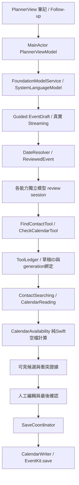

# MessyNote

**Turn messy thoughts into plans.** 一個獨立 SwiftUI iOS 技術展示：筆記 → 裝置端模型 → Guided Swift type → 真實 partial streaming → 模型發起唯讀工具 → 人工確認 → EventKit 寫入。

## 開啟與需求

開啟 `MessyNote.xcodeproj`，選擇 `MessyNote` scheme。專案由 `project.yml` 產生；只有重建專案才需執行 `xcodegen generate`，一般使用 Xcode 不需安裝額外 runtime dependency。

| 項目 | 實際環境／設定 |
|---|---|
| Xcode | 27.1 (27A9275) |
| iOS SDK | 27.1 |
| Swift compiler | 6.4；Swift language mode 6、strict concurrency complete |
| 最低部署版本 | iOS 27.0 |
| xcodegen | 2.44.1 |
| 已測 simulator | iPhone 18 Pro，iOS 27.0 |
| 真實模型 | Apple Intelligence 相容且已下載模型的裝置；App 即時檢查 availability 與 supportsLocale |

Framework 最早自 iOS 26 提供；本展示選用 iOS 27.0 部署並使用 SDK 27 API。實機需在 Xcode Signing & Capabilities 選擇自己的 Team；專案使用 Automatic Signing，只有 simulator 關閉簽署。沒有加入或要求任何雲端 LLM 金鑰。

[Apple 官方裝置、語言與地區需求](https://support.apple.com/en-us/121115) 可能變動，runtime 檢查才是本次可用性的依據。支援裝置例子包括 iPhone 15 Pro / Pro Max、iPhone 16 及後續相容機型；一般 iPhone 15 不符合。

## 展示能力與實際 API

| 能力 | 本專案 API／邊界 |
|---|---|
| 裝置端模型 | `SystemLanguageModel.default`；不使用 Private Cloud Compute 或第三方模型 |
| 可用性與語系 | `availability`、`supportsLocale(Locale.current)`；分別顯示裝置不符、未開啟、模型未就緒、語系不支援 |
| Guided Generation | `@Generable(representNilExplicitlyInGeneratedContent: true) EventDraft`、`DateIntent`、`EventRevision`／`EventField`、窄型`ClockCompletion`／`DurationCompletion`、`@Guide` 範圍／語意約束 |
| 真實 streaming | `LanguageModelSession.streamResponse(to:generating:options:)`；直接顯示 `Snapshot.content`；結束後以 `EventDraft(snapshot.rawContent)` 驗證完整型別 |
| 抽取穩定性 | `GenerationOptions(samplingMode: .greedy, maximumResponseTokens: 1024)`（revision為1536、clock-only為128），沒有假 timer 或硬編碼推論結果 |
| Tool calling | `FindContactTool`／`CheckCalendarTool: Tool`，由模型觸發 `call(arguments:)`；iOS27 `DynamicProfile`、`@SessionPropertyEntry`、`@SessionProperty`、`toolCallingMode`／`onToolCall`控制單次唯讀查詢 |
| 對話 | 保留 parse session，follow-up 附上使用者目前修改後的草稿 context |
| Contacts | `CNContactStore.requestAccess(for: .contacts)`；允許 authorized／limited，只查姓名且最多回傳20個 identifier/displayName |
| Calendar read | `EKEventStore.requestFullAccessToEvents()` 與 `predicateForEvents` |
| Calendar write | 僅 `CalendarWriter.save` 內有 `EKEventStore.save`，由最後人工確認路徑觸發 |

概念需求中的 Date 改成語意型別後由 Swift 計算。沒有走「模型 JSON 字串 → JSONDecoder」。Streaming 不保證欄位順序，UI 只呈現實際已有的欄位，部分結果不能儲存。

Follow-up產生typed `EventRevision { changes, values }`；`GenerationResult.applying`只套用`changes`列出的欄位，未列欄位保留。Baseline包含已驗證事件與尚缺時間的草稿；`GenerationResult.mergedDraft`先用Swift驗證日期並固定為explicit，單改時間不會重新計算先前的相對日期。明確「取消提醒」可列出reminder並給nil，並非nil一律回填。修改驗證失敗會保留前一份可用草稿並顯示原因。若pending草稿仍缺時間，畫面提供固定日期、時間選擇器與「使用此時間並查詢」；明確採用使用者選擇後，Swift驗證，再由真模型呼叫唯讀工具。已有完整或未完成草稿時都走revision；補時間仍以原草稿為baseline，只合併要求變更欄位。Revision的partial UI仍是模型當下values，最終才套用Swift merge。

C初次顯示缺時間後，可直接用自然語言補充，例如「晚上七點，吃飯一小時，同行者叫阿不存在」。即使一般revision漏列time，窄型clock抽取仍能完成時刻，同時保留日期並進入真正工具查詢。手動時間選擇保留為備用；未提供姓名也可在有效草稿的「參與者姓名」欄編輯，編輯後需重新取得工具證據。

缺時間的follow-up先依原revision allowlist合併。若原pending草稿與合併後草稿都缺時間，且revision沒有明確time變更，額外進行一次`ClockCompletion(clockPhrase, hasExplicitStartTime, hour, minute)`抽取。這個fresh session只收到最新一句使用者文字，沒有原日期或舊時刻context；結果只經既有time merge套入，不改日期、姓名或其他欄位。nil或非法clock仍待確認，不進工具review、不儲存。明確time清除、已有時間或有效事件都不額外抽取，沒有自動重試迴圈。新clock partial直接呈現真實snapshot，取消／重置／模式切換會清除並拒絕舊結果。

首次抽取後另用fresh `DurationCompletion`只確認活動時長；例如「半小時」是30分鐘，「兩小時前提醒」不是活動時長。未指定時長保留原值，非法值拒絕。首次草稿只有hour缺失時才用fresh `ClockCompletion`補抽；已有hour不再交給第二次模型覆蓋。補抽須clockPhrase非空且逐字包含於本次原文、hasExplicitStartTime為true且有hour才套用，未提供minute時由Swift補0；false或nilhour保持原草稿待確認。pending follow-up則保留既有條件，只在revision未明改時間時補抽。日期與其他欄位保持，revision不增加duration抽取。初始typed streaming保留；窄型檢查有額外推論延遲。

抽取與工具檢查刻意分開：parse session沒有tools，保留對話供follow-up。App在Swift驗證草稿後安排唯讀檢查階段，有參與者才檢查Contacts，再檢查Calendar。每個階段建立只注入一個tool的fresh session，明確選用`SystemLanguageModel.default`，要求模型產生參數並呼叫一次工具；第一次`onToolCall`後改為`.disallowed`，防止required模式無限重複呼叫。App不直接呼叫讀取service，UI不使用模型自由文字宣稱的衝突，只用ledger的已驗證結果。這展示受控tool invocation，而不是宣稱模型自主決定全部workflow。

## 架構與主要檔案



- `MessyNote/AI/`：模型 session、兩個工具、實際執行 ledger、錯誤分類。
- `MessyNote/Models/`：可生成的語意型別、typed revision／GenerationResult、已驗證事件、精簡候選與衝突、save review snapshot。
- `MessyNote/Services/`：日期、空檔、Contacts／Calendar讀取；獨立寫入與確認邊界。
- `MessyNote/Feature/Planner/`：主畫面、可編輯卡片、最後確認畫面與狀態。
- `MessyNote/Demo/`：只有 Debug 編譯的唯讀 fixture providers。
- `MessyNoteTests/`：Swift Testing deterministic 與取消／儲存安全測試。
- `docs/sdk-evidence.md`：本機 SDK interface 的 API 證據。
- `EVIDENCE.md`：階段建置、測試與實測限制；不把編譯通過當成模型行為驗證。

## 日期與查詢規則

每次生成提供當地 Gregorian 日期、星期、時區、locale 與現在 instant。今天／明天／後天使用 `dayOffset`，下週使用星期一=1到星期日=7，指「下一個週一開始的一週」；明確日期使用 year/month/day。初次相對日期以生成開始時間解析，之後保留已固定的日曆日期，除非revision要求修改日期。Prompt要求只有「晚上」而沒有時刻時輸出hour=nil；Swift會拒絕nil並要求補充。模型仍可能猜出有效時刻，型別與日期校驗無法證明其符合原文，使用者需檢查草稿。

`DateResolver` 拒絕無效日期、時刻及不存在的 DST 時刻；DST 重複時刻採 Foundation Calendar 預設選擇。台北現場展示沒有 DST。當手動修改日期、時長或姓名，原工具證據立即失效。接受建議時段也會清除舊查詢，可輸入「保留目前設定，再檢查」讓模型重新查詢。

Calendar 查詢從要求開始往後12小時，半開區間 `[start,end)`；事件正好在起始點結束不算衝突。空檔必須容納整段時長，並避開查到的全部事件，包含重疊／巢狀區間。查不到權限或模型未呼叫工具時，顯示「未知」，不宣稱沒衝突。工具資料是查詢當下的快照，儲存前行事曆可能已改變。

## 人工確認與權限

首次開啟不立即要權限。Contacts／Calendar 各自在模型真正呼叫工具時才請求。權限拒絕保留草稿並顯示不可用；Calendar 最終儲存仍必須取得系統權限。

0個聯絡人：保留原姓名並讓使用者明確選擇繼續。1個：顯示解析結果供檢查。多個：必須選候選或勾選保留未解析姓名，不讓模型偷偷選身份。Contacts limited 下沒有結果也可能是未授權那位聯絡人。

「加入行事曆」先打開可見的最終 review；只有「確認加入行事曆」才寫入預設行事曆。重複點擊、等待權限期間取消／草稿過期，都不會多寫。參與者僅記在事件 notes，**不發送 Calendar 邀請**，也不讀 email／電話。

## Debug Demo Mode

Debug build 可切換 Real Mode／Demo Fixture Mode，切換會取消舊生成、清除舊草稿與session。

- 小明 → 王小明／林小明兩個候選；Amy → Amy Chen；其他名稱 → 沒有結果。
- 以切換模式當時為基準，下週三15:00–16:00 Team Meeting，以及16:00–16:30準備時間，60分鐘行程得到16:30建議。
- Fixture僅替代唯讀資料；模型推論、typed streaming及tool calling仍是真的。
- Fixture setup不寫入系統聯絡人或行事曆。最後儲存仍寫入系統，確認畫面會明確說明。
- Release不包含fixture型別或切換UI。

## Live Demo 前準備

1. 在相容實機安裝 Debug，確認 Apple Intelligence 開啟、語言設定完成、模型下載完畢，App 顯示模型可使用。
2. 使用台北時區並確認當天日期。先在有網路時完成模型準備；模型可用後才切飛航模式。
3. 準備可寫入的測試行事曆。Real Mode 要先準備聯絡人與事件；Fixture Mode 可固定展示候選與衝突。
4. 先完整彩排一次範例、改時間與最後確認；場上若不想寫事件，停在最後 review 即可。
5. 記錄本機的實測結果與可用性；模型不一定每次正確抽取或呼叫工具，UI會誠實顯示未知。

## 90秒 Demo Script

| 時間 | 操作與說明 |
|---|---|
| 0–10秒 | 顯示availability，開啟Fixture Mode：「真實裝置端模型，只有聯絡人與行事曆資料是固定的。」 |
| 10–30秒 | 填入「下週三下午三點跟小明在信義區喝咖啡一小時，記得帶合約，前一天提醒我」，按Make it happen。 |
| 30–45秒 | 指出欄位隨真實partial snapshots出現，說明輸出是`@Generable` Swift type。 |
| 45–60秒 | 展開AI Activity，指出真正FindContactTool／CheckCalendarTool；選王小明；查看15:00衝突與16:30的Swift空檔結果。 |
| 60–75秒 | 輸入「好，那改成16:30」，展示保留session與current draft context。檢查日期、時間、提醒，若再次出現多位候選請重新選擇參與者。 |
| 75–90秒 | 按加入行事曆，指出最後確認邊界；需要實際寫入才按確認，展示成功回饋。 |

推論延遲依裝置與系統負載變動，90秒是講解腳本而不是效能保證。

延伸到5–10分鐘：展示Amy的30分鐘與兩小時提醒、只有晚上時以自然語言補充確切時間（手動確認為備用）、權限拒絕仍保留草稿、多個候選不自動挑人、手動修改使證據失效；最後在模型已就緒的實機切飛航模式重跑。不要把測試fixture當成真實系統資料或假裝工具已被呼叫。

## 隱私

AI使用Apple裝置端`SystemLanguageModel.default`，沒有第三方LLM API、backend、analytics或網路請求。傳給模型的聯絡人資料限查詢候選姓名與identifier；Calendar工具返回衝突摘要及經Swift計算的時段，不送整份日曆。App沒有持久化對話或新增資料庫。

Contacts／Calendar本身可能由系統或iCloud同步；因此不宣稱「所有資料永遠不離開裝置」。飛航模式可展示已就緒的裝置端AI不需要第三方推論服務，不能代替所有系統同步生命週期的說明。

## 驗證與限制

2026-10-22最終v12：**62項unit通過、同版本A–D共4項真UI驗收全通過，UI建置與generic iOS unsigned Release成功**。B/C與A/D分兩次執行，皆0失敗；B完整涵蓋中文替換、15:00衝突、16:30 follow-up保留欄位、兩工具與review取消。缺hour補抽新增原文鐘點片段核對，已有hour流程保持。[驗收摘要與證據](docs/final-acceptance/v12/verification.md)保存同版結果；歷史失敗見[EVIDENCE](EVIDENCE.md)。這不代表A–F全部完成或模型每次都正確。

A/B/C使用真實FoundationModels＋唯讀fixtures，驗證中文輸入、結構化草稿與模型tool calls。A亦開啟儲存review後取消。D使用Real Mode、捕捉真正Simulator Calendar權限prompt並點拒絕，驗證草稿保留且衝突狀態未知。沒有手動選時間或最終Calendar寫入；fixture結果不等於真系統資料整合，Simulator也不等於實機。

E已用Xcode官方Run診斷驗證modelNotReady及deviceNotEligible UI。Polish語言probe仍停modelNotReady，因此unsupported-locale未驗證；Apple Intelligence disabled亦未測。F的飛航推論仍須模型已就緒的相容實機。

23:37 CST唯讀preflight確認iPhone17Pro已connected（localNetwork／TCP）、Developer Mode enabled，且是Xcode相容目的地。Team仍空，尚未簽署安裝、未執行App，模型就緒未知；需選Team後才能繼續實機驗證。[最新實機前置檢查](docs/final-acceptance/v12/phone17-preflight-redacted.md)與[歷史preflight](docs/final-acceptance/phone17-preflight.md)分開保存。

一般`MessyNote` scheme只跑unit。A–D真模型UI使用獨立`MessyNoteAcceptanceUI` scheme；D必須先重設專用測試Simulator的Calendar權限，讓它真正出現prompt。以下命令只用於測試機，以自己的UDID取代placeholder：

```sh
xcrun simctl privacy <YOUR_SIMULATOR_UDID> reset calendar com.demo.MessyNote
xcodebuild -project MessyNote.xcodeproj -scheme MessyNoteAcceptanceUI \
  -destination 'platform=iOS Simulator,id=<YOUR_SIMULATOR_UDID>' \
  -parallel-testing-enabled NO -collect-test-diagnostics never test
```

可加`-only-testing:MessyNoteUITests/CaseCUITests`單跑C；既有`MessyNoteCaseCUI` scheme保留。模型不可用、未出現必要系統prompt或超過等待時間會失敗，不會skip或當作通過。所有UI測試都不會按下最終寫入Calendar的確認。

模型仍可能漏抽時刻、誤解星期、錯列revision changes或產生無效tool參數；Guided Generation保證結構，不保證語意。已依真模型觀察校準weekday/hour Guide與greedy sampling，但仍需使用者檢查。context超出時需重置；取消進行中的請求會換新session，已完成的session支援follow-up。Fixture查詢不代表使用者真實行事曆無衝突。

沒有額外lint工具設定；Swift compiler strict concurrency檢查與build/test是本專案驗證入口。Xcode可能輸出「無AppIntents依賴，跳過metadata」訊息，不代表本專案使用AppIntents。

若只剩30分鐘，優先處理：

1. 用要上台的實機完整彩排B與follow-up，確認當前模型準備、語系、權限與實際tool calls。
2. 校驗現場日期／時區與15:00、16:30資料，準備不寫入的最後review作備援；清理彩排事件。
3. 實測飛航模式與耗時；若模型不就緒，展示真實不可用UI、已有驗證紀錄與程式碼，不使用假推論替代。
